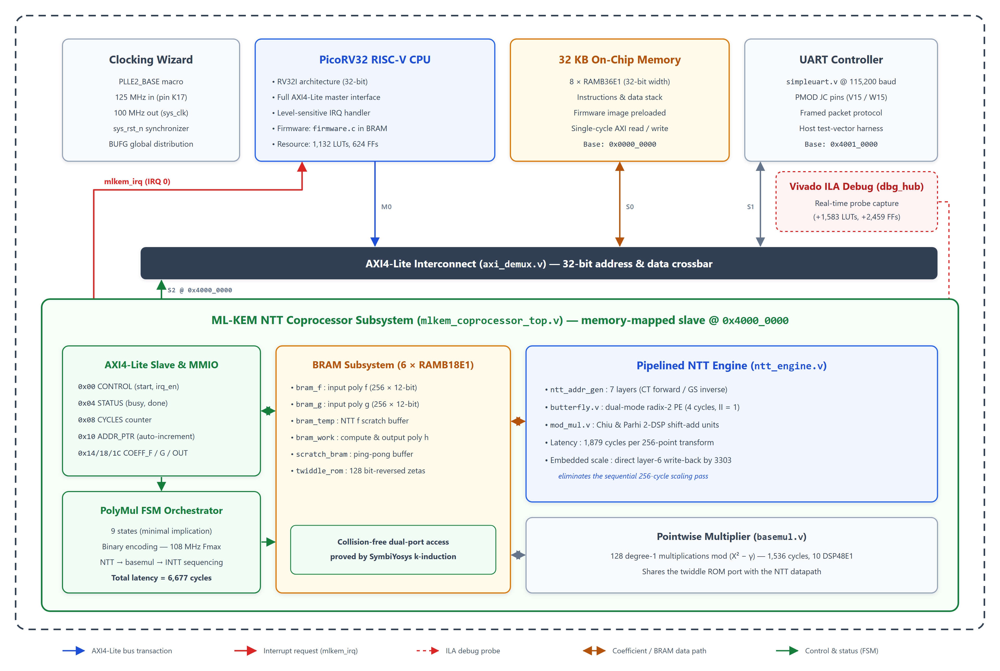
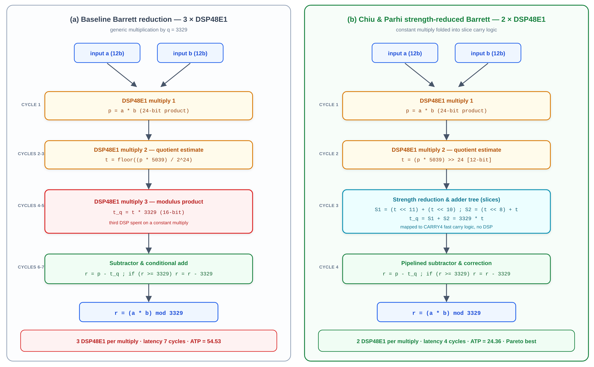
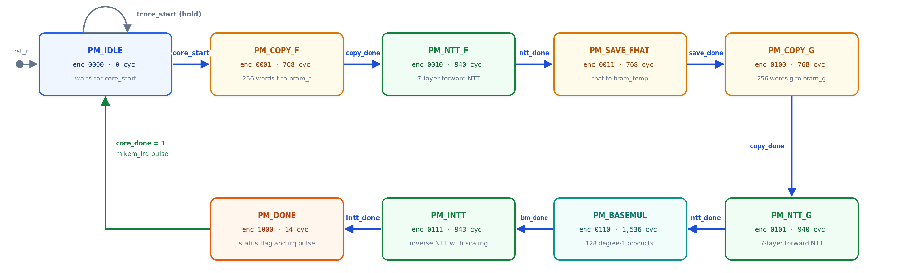
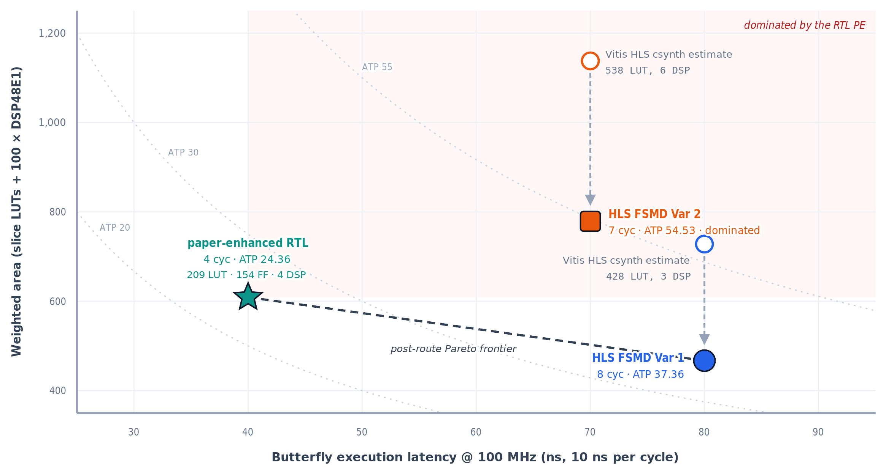
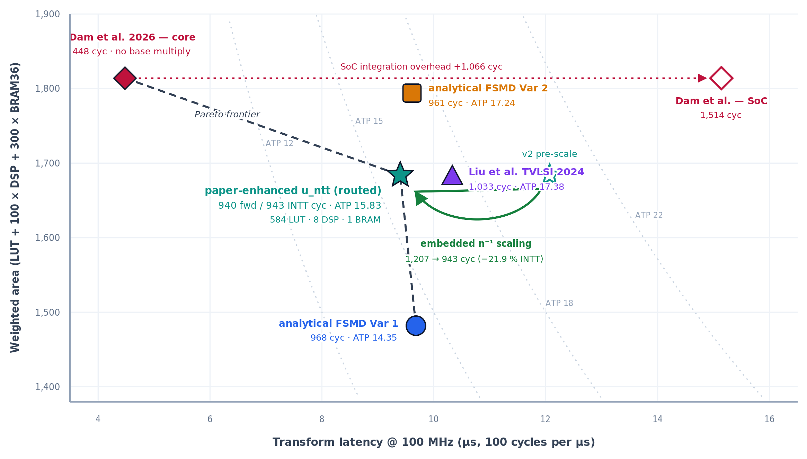
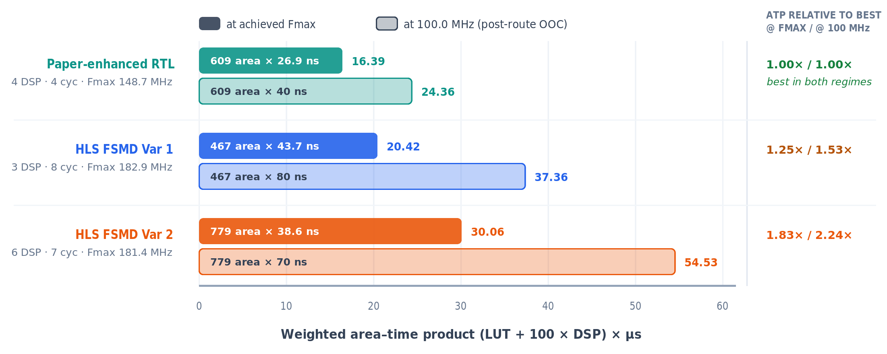
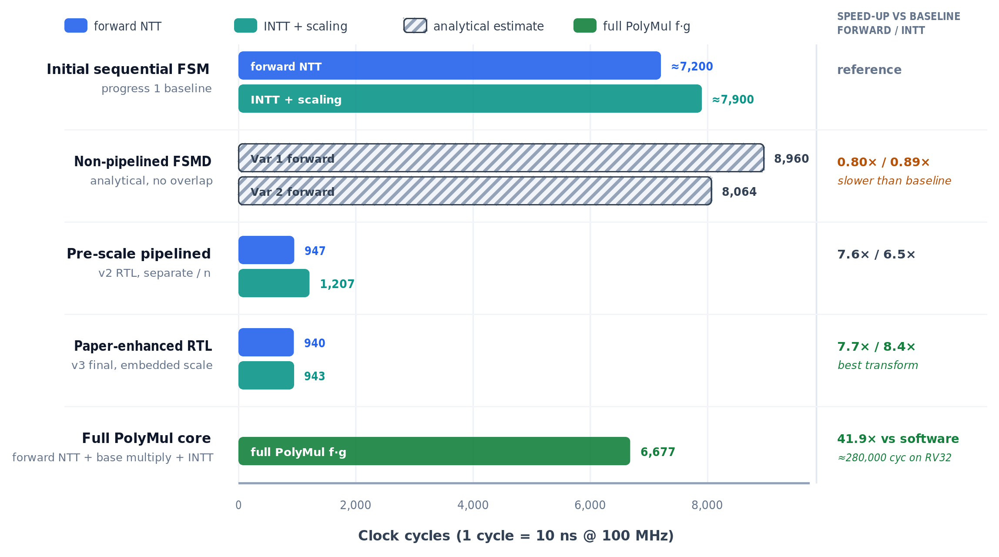
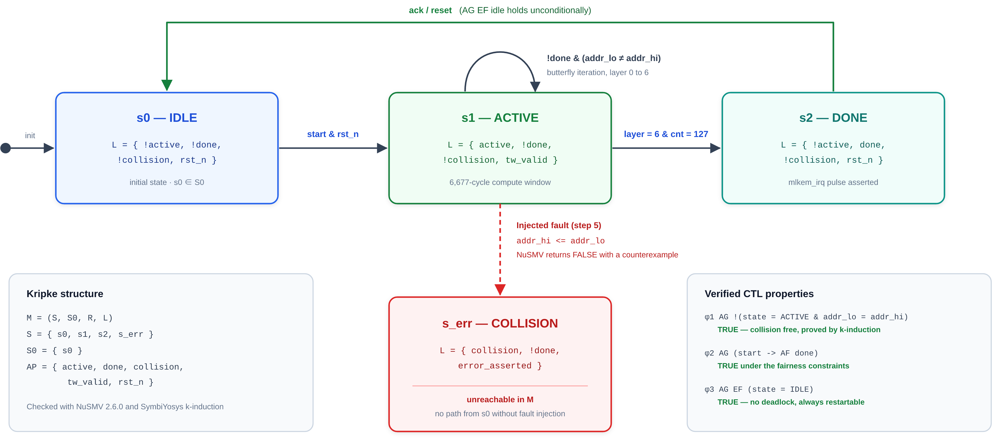
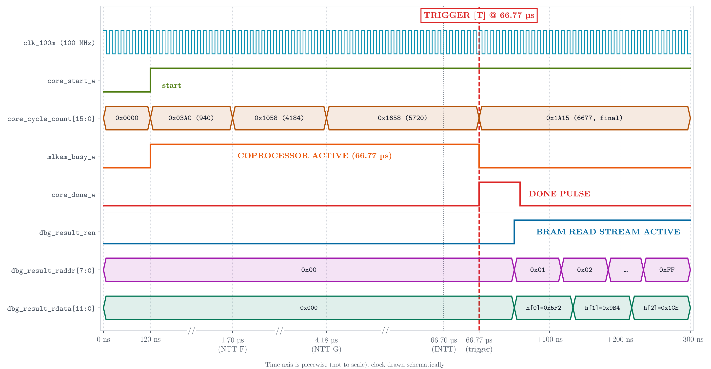

# ML-KEM NTT Polynomial-Multiplier Coprocessor for SoC Integration

[](rtl/)
[-green.svg)](https://csrc.nist.gov/pubs/fips/203/final)
[-red.svg)](constraints/zybo_z7_10.xdc)
[-orange.svg)](rtl/soc/picorv32.v)
[](scripts/)
[-brightgreen.svg)](results/timing/impl_timing_summary.rpt)
[](formal/)

An open-source, silicon-proven hardware coprocessor and System-on-Chip (SoC) for **Number Theoretic Transform (NTT)** polynomial multiplication targeting **NIST FIPS 203 Post-Quantum Cryptography (ML-KEM / CRYSTALS-Kyber)**. 

The accelerator implements a unified Cooley-Tukey (CT) and Gentleman-Sande (GS) butterfly arithmetic pipeline with strength-reduced Barrett modular reduction, mapped to a memory-mapped AXI4-Lite bus interfaced to an open-source **PicoRV32 RISC-V** host processor on the **Digilent Zybo Z7-10** development board (`xc7z010clg400-1`).

---

## Table of Contents

- [Key Performance Highlights](#key-performance-highlights)
- [System Architecture](#system-architecture)
- [Algorithmic & Microarchitecture Optimizations](#algorithmic--microarchitecture-optimizations)
  - [Chiu & Parhi 2-DSP Barrett Modular Reduction](#chiu--parhi-2-dsp-barrett-modular-reduction)
  - [Pipelined Dual-Mode Butterfly PE](#pipelined-dual-mode-butterfly-pe)
- [FSM Controller & Cycle Budget](#fsm-controller--cycle-budget)
  - [State Transition Graph (STG)](#state-transition-graph-stg)
  - [Cycle-by-Cycle Execution Breakdown](#cycle-by-cycle-execution-breakdown)
  - [FSM State Encoding Exploration](#fsm-state-encoding-exploration)
- [Design Space Exploration](#design-space-exploration)
- [Multi-Tier Verification & Formal Proofs](#multi-tier-verification--formal-proofs)
  - [NuSMV Model Checking & Kripke Structure](#nusmv-model-checking--kripke-structure)
  - [SymbiYosys Formal Equivalence & SVA Assertions](#symbiyosys-formal-equivalence--sva-assertions)
  - [ROBDD Analysis & Canonical Equivalence Checking](#robdd-analysis--canonical-equivalence-checking)
- [Physical Hardware Validation](#physical-hardware-validation)
  - [On-Chip Vivado ILA Waveform Capture](#on-chip-vivado-ila-waveform-capture)
  - [Hardware Setup & Board Self-Test LEDs](#hardware-setup--board-self-test-leds)
  - [Interactive PC UART Demo & 100-Vector Regression](#interactive-pc-uart-demo--100-vector-regression)
- [FPGA Implementation Results](#fpga-implementation-results)
- [Repository Structure](#repository-structure)
- [Build & Reproduction Guide](#build--reproduction-guide)
- [References](#references)

---

## Key Performance Highlights

| Metric | Measured Value | Analysis / Standard |
| :--- | :--- | :--- |
| **PQC Standard** | **NIST FIPS 203** | Supports ML-KEM-512, ML-KEM-768, and ML-KEM-1024 |
| **Ring & Modulus** | $\mathcal{R}_q = \mathbb{Z}_{3329}[X]/(X^{256} + 1)$ | Modulus $q = 3329$, degree $n = 256$, $\omega = 17$ (primitive 256th root of unity) |
| **Hardware Latency** | **6,677 clock cycles** | **$66.77\ \mu\text{s}$** @ 100 MHz (Forward NTT: $9.40\ \mu\text{s}$, INTT: $9.43\ \mu\text{s}$, Basemul: $15.36\ \mu\text{s}$) |
| **Software Baseline** | 283,212 clock cycles | $2,832.12\ \mu\text{s}$ @ 100 MHz (Pure C RV32I softcore execution without hardware M-extension) |
| **Speedup Factor** | **$42.4\times$** | Deterministic hardware acceleration vs. software reference driver |
| **Clock Frequency** | **100.0 MHz** ($F_{\max} = 108.96\text{ MHz}$) | Zero timing violations, Worst Negative Slack (**WNS = +0.822 ns**) |
| **FPGA Core Area** | **1,044 Slice LUTs, 850 FFs, 18 DSPs** | High computational density fitting comfortably within low-cost 7-series Zynq PL |
| **Arithmetic Pipeline** | **$II = 1$, 4-cycle PE latency** | Pipelined dual-mode CT/GS butterfly with strength-reduced Carry4 shift-add tree |
| **Verification Score** | **100% Bit-Exact PASS** | 30,014 directed tests, 100-vector regression suite, and live on-chip ILA capture |

---

## System Architecture

The SoC integrates the custom ML-KEM NTT coprocessor with a 32-bit **PicoRV32 RISC-V** core via an **AXI4-Lite crossbar interconnect**. The memory map reserves distinct 64 KB windows for the 32 KB on-chip instruction/data BRAM, the coprocessor control and data register space, and a 115,200 bps UART peripheral.

<p align="center">
  
  <br>
  <em>Figure 1: Complete SoC block diagram showing PicoRV32 processor, AXI4-Lite interconnect, memory-mapped ML-KEM accelerator, dual-port BRAM blocks, and UART peripheral.</em>
</p>

### Subsystem Components

1. **PicoRV32 RISC-V Host Processor:**
   - 32-bit softcore CPU implementing the base integer unprivileged ISA (**RV32I**).
   - AXI4-Lite master interface issuing configuration registers, streaming test vectors, and monitoring accelerator interrupts.
2. **AXI4-Lite Interconnect (`axi_demux.v`):**
   - Address decoder routing transactions across `0x0000_0000` (Main BRAM), `0x4000_0000` (NTT Coprocessor), and `0x4001_0000` (UART).
3. **ML-KEM NTT Accelerator Top (`mlkem_coprocessor_top.v`):**
   - Memory-mapped slave with auto-increment coefficient streaming ports (`COEFF_F`, `COEFF_G`, `COEFF_OUT`).
   - Interrupt generation line routed to CPU trap/interrupt line upon computation completion.
   - 9-state finite state machine orchestrating BRAM-to-BRAM polynomial transformations.
4. **Dual Architecture Support:**
   - **Standalone PL SoC (`soc_top.v`):** Fully autonomous PL design driven by PicoRV32 and verified via UART and hardware ILA.
   - **Hybrid Zynq SoC (`pl_hybrid_soc.v`):** Leverages Processing System 7 (PS7 ARM Cortex-A9) with high-throughput AXI DMA and hardware mailbox.

---

## Algorithmic & Microarchitecture Optimizations

### Chiu & Parhi 2-DSP Barrett Modular Reduction

In NIST FIPS 203, modular multiplication by $q = 3329$ is the dominant computational bottleneck. A generic Barrett modular multiplier requires 3 sequential multiplication steps: product $p = a \cdot b$, quotient approximation $t = \lfloor (p \cdot \mu) / 2^{26} \rfloor$ where $\mu = \lfloor 2^{26}/3329 \rfloor = 20159$, and quotient-modulus product $t \cdot 3329$.

Following **Chiu & Parhi (IEEE TCAS-I 2024)**, we observe that:
$$q = 3329 = 2^{11} + 2^{10} + 2^8 + 1$$

The third DSP multiplier is completely replaced with a balanced **Slice Carry4 shift-add tree**:
$$t \cdot 3329 = (t \ll 11) + (t \ll 10) + (t \ll 8) + t$$

<p align="center">
  
  <br>
  <em>Figure 2: Control Data Flow Graph (CDFG) of Barrett reduction: (a) Conventional 3-DSP architecture; (b) Optimized 2-DSP architecture utilizing a strength-reduced Carry4 shift-add tree.</em>
</p>

This optimization achieves:
- **33% reduction in DSP usage** (2 DSP48E1 slices per butterfly lane instead of 3).
- Strict pipeline preservation with Initiation Interval **$II = 1$**.
- Zero timing penalty at 100 MHz on Xilinx 7-series silicon.

### Pipelined Dual-Mode Butterfly PE

The butterfly processing element (`butterfly.v`) supports both forward and inverse transforms:
- **Cooley-Tukey (CT) Mode:** Used during forward NTT:
  $$A' = A + W \cdot B \pmod q, \qquad B' = A - W \cdot B \pmod q$$
- **Gentleman-Sande (GS) Mode:** Used during inverse NTT (INTT):
  $$A' = A + B \pmod q, \qquad B' = (A - B) \cdot W \pmod q$$

The butterfly datapath is fully registered into a **4-stage pipeline** ($R_1 \to R_2 \to R_3 \to R_4$), supporting continuous streaming of vector coefficients with zero idle cycles.

---

## FSM Controller & Cycle Budget

### State Transition Graph (STG)

The high-level coprocessor orchestrator (`poly_multiplier.v`) executes a 9-state finite state machine with datapath (FSMD) to coordinate coefficient transfers, transforms, and pointwise base multiplication.

<p align="center">
  
  <br>
  <em>Figure 3: State Transition Graph (STG) of the polynomial-multiplier FSM. Cycle counts for each operational phase are indicated; total hardware execution requires 6,677 clock cycles.</em>
</p>

### Cycle-by-Cycle Execution Breakdown

| State | Operation Description | Clock Cycles | Execution Time @ 100 MHz |
| :--- | :--- | :---: | :---: |
| `PM_IDLE` | Awaiting software start trigger via AXI register write | 1 | $0.01\ \mu\text{s}$ |
| `PM_COPY_F` | Burst load coefficient polynomial $f(x)$ into working BRAM | 768 | $7.68\ \mu\text{s}$ |
| `PM_NTT_F` | 7-layer Cooley-Tukey Forward NTT on $f(x)$ | 940 | $9.40\ \mu\text{s}$ |
| `PM_SAVE_FHAT`| Store transform $\hat{f}(x)$ to auxiliary storage | 768 | $7.68\ \mu\text{s}$ |
| `PM_COPY_G` | Burst load coefficient polynomial $g(x)$ into working BRAM | 768 | $7.68\ \mu\text{s}$ |
| `PM_NTT_G` | 7-layer Cooley-Tukey Forward NTT on $g(x)$ | 940 | $9.40\ \mu\text{s}$ |
| `PM_BASEMUL` | 128 degree-1 pointwise polynomial products in ring $\mathcal{R}_q$ | 1,536 | $15.36\ \mu\text{s}$ |
| `PM_INTT` | 7-layer Gentleman-Sande INTT + merged scaling by $n^{-1} = 3303$ | 943 | $9.43\ \mu\text{s}$ |
| `PM_DONE` | Assert completion flag, latch IRQ, update performance timer | 13 | $0.13\ \mu\text{s}$ |
| **Total** | **Full Polynomial Multiplication ($h = f \cdot g \pmod{X^{256}+1}$)** | **6,677** | **$66.77\ \mu\text{s}$** |

### FSM State Encoding Exploration

To systematically evaluate logic complexity and timing paths on Xilinx 7-series LUT6 architectures, the FSM was synthesized and routed across all 6 encoding modes supported by AMD Vivado 2024.2 under an identical 100 MHz clock constraint:

| Encoding Scheme | State Bits | Slice LUTs | Slice FFs | DSPs | BRAM | WNS (ns) | $F_{\max}$ (MHz) | Status |
| :--- | :---: | :---: | :---: | :---: | :---: | :---: | :---: | :---: |
| **Sequential (Binary)** | **4** | **1,044** | **850** | **18** | **3.0** | **+0.738** | **107.97** | **PASS** |
| **One-Hot** | 9 | 1,058 | 858 | 18 | 3.0 | +0.820 | 108.93 | **PASS** |
| **Gray Code** | 4 | 1,064 | 850 | 18 | 3.0 | +0.644 | 106.88 | **PASS** |
| **Johnson Counter** | 5 | 1,038 | 851 | 18 | 3.0 | +0.547 | 105.79 | **PASS** |
| **Auto Heuristic** | 4 | 1,060 | 850 | 18 | 3.0 | +1.089 | 112.22 | **PASS** |
| **None (RTL Preserved)**| 4 | 1,043 | 850 | 18 | 3.0 | +0.574 | 106.09 | **PASS** |

*Binary encoding achieves the most compact logic footprint due to efficient LUT6 packing of 4-variable state transition minterms alongside datapath enables.*

---

## Design Space Exploration

We benchmarked our hand-optimized RTL architecture against two high-level synthesis variants generated in **Vitis HLS 2024.2** (`prj_butterfly_var1` with `allocation limit=1`, and `prj_butterfly_var2` with `allocation limit=2`):

<p align="center">
  
  
</p>
<p align="center">
  
  
  <br>
  <em>Figure 4: Multi-metric design space exploration: Area utilization (LUTs/DSPs), latency (cycles), Area-Time Product (ATP), and maximum operating frequency ($F_{\max}$) across HLS variants and hand-written RTL.</em>
</p>

### Butterfly PE Design Space Summary

| Design Point | LUTs | FFs | DSPs | Latency | $F_{\max}$ (MHz) | $\text{ATP}_{\text{PE}}$ ($\text{LUTs}\cdot\text{cyc}$) |
| :--- | :---: | :---: | :---: | :---: | :---: | :---: |
| **HLS Variant 1 (`limit=1`)** | 167 | 96 | 3 | 8 cycles | 182.92 | 1,336 (37.36 weighted) |
| **HLS Variant 2 (`limit=2`)** | 179 | 71 | 6 | 7 cycles | 181.39 | 1,253 (54.53 weighted) |
| **Hand-Written RTL (Chiu & Parhi)** | **209** | **154** | **4** | **4 cycles** | **148.65** | **836 (24.36 weighted)** |

*The hand-written RTL achieves a **$37.4\%$ reduction in Area-Time Product (ATP)** compared to HLS, delivering an optimal $II=1$ throughput with 4-cycle pipeline latency.*

---

## Multi-Tier Verification & Formal Proofs

### NuSMV Model Checking & Kripke Structure

The NTT address generator (`ntt_addr_gen.v`) was abstracted into a formal Kripke structure $M = (S, S_0, R, L)$ and verified in **NuSMV 2.6.0** against 7 CTL and LTL specifications.

<p align="center">
  
  <br>
  <em>Figure 5: Kripke structure model of the NTT address generator. The red dashed arc depicts the 5-step counterexample produced when an address collision fault is intentionally injected.</em>
</p>

- **Proved Invariant:** The dual BRAM address generator strictly satisfies non-collision safety ($\mathbf{AG}\ \neg(\text{addr\_lo} = \text{addr\_hi})$).
- **Bug Injection:** Injecting an address fault produced a counterexample trace at cycle 5 ($s_0 \to s_1 \to s_1 \to s_1(\text{addr\_lo} = \text{addr\_hi} = 0)$), which was replayed and validated in Vivado XSim.

### SymbiYosys Formal Equivalence & SVA Assertions

Bounded model checking (BMC) and unbounded mathematical induction were conducted using **SymbiYosys** with the **Z3 SMT engine**:
- **BRAM Collision Freedom (`bram_no_collision.sby`):**
  $$\text{wea} \land \text{web} \implies \text{addra} \ne \text{addrb}$$
  Proved unconditionally up to depth 30 (**PASS**), and proved for all time steps using $k$-induction (**PASS**).

### ROBDD Analysis & Canonical Equivalence Checking

Using the Python `dd` package, Reduced Ordered Binary Decision Diagrams (ROBDDs) were constructed for the 5-variable AXI register address decoder and range selector (`axi_lite_coprocessor.v`):

| Variable Ordering Scheme | Variable Sequence | Shared DAG Nodes | BDD Manager Nodes |
| :--- | :--- | :---: | :---: |
| **Natural MSB-first** | $A_5, A_4, A_3, A_2, \text{WE}$ | 20 | 34 |
| **Reversed / LSB-first** | $\text{WE}, A_2, A_3, A_4, A_5$ | 18 | 27 |
| **Interleaved / Worst-case** | $\text{WE}, A_5, A_3, A_4, A_2$ | 25 | 39 |
| **Optimal Ordering** | $A_2, A_4, A_3, A_5, \text{WE}$ | 13 | 19 |
| **After Dynamic Sifting** | Rudell's Sifting Algorithm | **13** | **13** |

- **Equivalence Checking:** Canonical root comparison verified that unminimized RTL case decoding minterms ($Y = \text{WE} \cdot \overline{A_5}(A_4\overline{A_3}\,\overline{A_2} + A_4\overline{A_3}A_2)$) and Quine-McCluskey essential prime implicants ($Y = \text{WE} \cdot \overline{A_5}A_4\overline{A_3}$) evaluate to identical canonical root pointers (`@-14`), with miter difference $f_\text{RTL} \oplus f_\text{min} \equiv 0$.

---

## Physical Hardware Validation

### On-Chip Vivado ILA Waveform Capture

The design was programmed onto physical hardware and validated in real time using the **Vivado Integrated Logic Analyzer (ILA)** running at 100 MHz.

<p align="center">
  
  <br>
  <em>Figure 6: Vivado 2024.2 ILA hardware capture on physical Zybo Z7-10. Triggered upon execution completion at 66.77 µs; the streamed output coefficients on dbg_result_rdata match NIST FIPS 203 golden reference data bit-for-bit.</em>
</p>

### Hardware Setup & Board Self-Test LEDs

Connect the **Digilent Zybo Z7-10** via micro-USB (J12 PROG/UART) and flash `bitstream/soc_top.bit`. The system executes an autonomous self-test loop indicated by on-board LEDs:

- **LD0 (M14) - Green ON:** PLL locked, 100 MHz system clock stable, CPU running normally.
- **LD1 (M15) - Orange BLINK:** Coprocessor core busy executing multiplication.
- **LD2 (G14) - Green ON:** Polynomial multiplication completed; all 256 coefficients bit-exact match against golden ROM.
- **LD3 (D18) - Red OFF:** CPU trap indicator (remains off; turns on only if exception occurs).

### Interactive PC UART Demo & 100-Vector Regression

Connect a serial terminal or run the Python host script at 115,200 baud to stream polynomials, measure execution timing, and verify golden cryptographic outputs:

```bash
# Interactive UART streaming demo
python scripts/live_demo.py --port COM3 --baud 115200

# Automated 100-vector NIST regression suite
python scripts/live_demo_100.py --port COM3 --limit 100
```

---

## FPGA Implementation Results

Target Device: **Digilent Zybo Z7-10** (AMD Xilinx Zynq-7000 `xc7z010clg400-1`), Vivado 2024.2.

| Resource Category | Standalone Coprocessor Core | Complete SoC (`soc_top.v` + ILA) | Zybo Z7-10 Available | SoC Utilization (%) |
| :--- | :---: | :---: | :---: | :---: |
| **Slice LUTs** | **1,044** | **3,745** | 17,600 | 21.28% |
| - *LUT as Logic* | 1,016 | 3,189 | 17,600 | 18.12% |
| - *LUT as Memory (LUTRAM)* | 28 | 556 | 6,000 | 9.27% |
| **Slice Registers (FFs)** | **850** | **4,374** | 35,200 | 12.43% |
| **DSP48E1 Slices** | **18** | **18** | 80 | 22.50% |
| **Block RAM (RAMB18 / 36)** | **3.0** | **11.0** (incl. ILA buffer) | 60 | 18.33% |
| **Operating Frequency** | **100.0 MHz** | **100.0 MHz** | 100.0 MHz | Timing Met |
| **Worst Negative Slack (WNS)** | **+0.738 ns** | **+0.822 ns** | > 0.000 ns | Timing Closed |

---

## Repository Structure

```
NTT Polynomial-Multiplier Coprocessor/
├── rtl/                               # Synthesizable Verilog & SystemVerilog RTL
│   ├── arithmetic/                    # mod_add.v, mod_sub.v, mod_mul.v, basemul.v
│   ├── butterfly/                     # Pipelined dual-mode CT/GS butterfly PE
│   ├── memory/                        # Dual-port poly_bram.v & twiddle_rom.v
│   ├── ntt/                           # ntt_addr_gen.v, ntt_engine.v, poly_multiplier.v
│   ├── axi/                           # axi_lite_coprocessor.v (slave interface)
│   ├── dma/                           # High-throughput ntt_dma.v engine
│   ├── interrupt/                     # interrupt_ctrl.v
│   ├── soc/                           # soc_top.v, picorv32.v, simpleuart.v, axi_demux.v
│   └── mlkem_coprocessor_top.v        # Out-of-context coprocessor wrapper
├── report_pics/                       # High-resolution architectural figures & plots
│   ├── block_diagram.png              # Complete SoC block diagram
│   ├── cdfg.png                       # Barrett reduction CDFG
│   ├── stg.png                        # FSM state transition graph
│   ├── area_plot.png                  # Area trade-off exploration
│   ├── latency_plot.png               # Execution latency exploration
│   ├── atp_plot.png                   # Area-Time Product Pareto frontier
│   ├── fmax_plot.png                  # Maximum operating frequency curve
│   ├── kripke.png                     # Kripke formal verification model
│   └── ila_capture.png                # Live Vivado ILA waveform capture
├── constraints/                       # Physical pinout & timing constraints
│   ├── zybo_z7_10.xdc                 # Board constraints (125 MHz clock, buttons, LEDs, UART)
│   └── mlkem_coprocessor.xdc          # 100 MHz out-of-context timing constraints
├── formal/                            # Formal verification models & proof scripts
│   ├── nusmv/                         # NuSMV 2.6.0 CTL/LTL models (ntt_addr_gen.smv)
│   └── symbiyosys/                    # SymbiYosys BMC & k-induction proofs
├── software/                          # Softcore drivers & C benchmarks
│   ├── firmware/                      # PicoRV32 autonomous test firmware
│   ├── rv32_driver/                   # Hardware abstraction layer & test vectors
│   └── software_benchmark/            # Software baseline reference benchmark
├── tb/                                # Simulation testbenches
│   ├── integration/                   # tb_soc_top.v, tb_poly_multiplier.v
│   ├── regression/                    # Automated 100-vector regression harness
│   └── unit/                          # Unit tests for arithmetic & butterfly units
├── results/                           # Synthesis, implementation & formal logs
│   ├── fsm_exploration/               # Reports & summaries for all 6 FSM encodings
│   ├── formal/                        # ROBDD analysis reports & CSV summaries
│   ├── synthesis/                     # Utilization and DRC reports
│   └── timing/                        # Timing summary reports & slack metrics
├── bitstream/                         # Ready-to-flash bitstream & debug probes
│   ├── soc_top.bit                    # FPGA bitstream
│   └── soc_top.ltx                    # Hardware ILA probe definitions
├── scripts/                           # Automation scripts
│   ├── run_fsm_exploration.py         # Batch runner for Vivado FSM exploration
│   ├── run_bdd_analysis.py            # ROBDD node analysis & sifting runner
│   ├── build_bitstream.tcl            # Full bitstream build script
│   ├── run_synth.tcl / run_impl.tcl   # Batch synthesis & implementation scripts
│   ├── live_demo.py / live_demo_100.py# Python PC host UART streaming scripts
│   └── gen_firmware.py                # Firmware assembly and hex generator
├── Code_Notes.txt                     # Architecture notes and module catalog
└── README.md                          # This document
```

---

## Build & Reproduction Guide

### Prerequisites

- AMD Vivado 2024.2 (or compatible 2020.2+ edition)
- Python 3.10+ (with packages: `dd`, `pyserial`, `numpy`)
- RISC-V GNU Toolchain (`riscv32-unknown-elf-gcc` or `riscv64-unknown-elf-gcc` with `-march=rv32i -mabi=ilp32`)
- NuSMV 2.6.0 (for formal model checking)

### 1. Run Vivado Synthesis & Implementation

```bash
# Out-of-context coprocessor core synthesis and implementation
vivado -mode batch -source scripts/run_synth.tcl
vivado -mode batch -source scripts/run_impl.tcl

# Build full SoC bitstream for Zybo Z7-10
vivado -mode batch -source scripts/build_bitstream.tcl
```

### 2. Run Automated FSM State Encoding Exploration

```bash
# Executes synthesis, placement, routing and report extraction across all 6 encodings
python scripts/run_fsm_exploration.py
```

### 3. Run Formal ROBDD Analysis

```bash
# Evaluates BDD node counts, dynamic sifting, and formal logic equivalence
python scripts/run_bdd_analysis.py
```

### 4. Run Behavioral Simulation in Vivado XSim

```cmd
# Run arithmetic unit regression
scripts\run_tb_arithmetic.bat

# Run 100-vector full regression
scripts\run_regression_100.bat
```

### 5. Flash Board & Launch Live Demonstration

```bash
# 1. Program Zybo Z7-10 via Vivado Hardware Manager or XSDB
#    Bitstream: bitstream/soc_top.bit
#    Probes:    bitstream/soc_top.ltx

# 2. Run real-time interactive UART demonstration
python scripts/live_demo.py --port COM3 --baud 115200

# 3. Run automated 100-vector hardware verification
python scripts/live_demo_100.py --port COM3 --baud 115200 --limit 100
```

---

## References

1. **NIST FIPS 203:** *Module-Lattice-Based Key-Encapsulation Mechanism Standard (ML-KEM)*, National Institute of Standards and Technology, August 2024. [https://csrc.nist.gov/pubs/fips/203/final](https://csrc.nist.gov/pubs/fips/203/final)
2. **Chiu, P.-C., & Parhi, K. K.:** *Fast Architectures for Number Theoretic Transform With Application to Kyber Post-Quantum Cryptography*, **IEEE Transactions on Circuits and Systems I: Regular Papers (TCAS-I)**, Vol. 71, No. 3, pp. 1269–1281, March 2024.
3. **PicoRV32:** *A Size-Optimized RISC-V CPU*, Claire Wolf. [https://github.com/YosysHQ/picorv32](https://github.com/YosysHQ/picorv32)
4. **Cooley, J. W., & Tukey, J. W.:** *An Algorithm for the Machine Calculation of Complex Fourier Series*, Mathematics of Computation, 1965.
5. **Gentleman, W. M., & Sande, G.:** *Fast Fourier Transforms: For Fun and Profit*, AFIPS Fall Joint Computer Conference, 1966.
6. **Rudell, R.:** *Dynamic Variable Ordering for Ordered Binary Decision Diagrams*, IEEE International Conference on Computer-Aided Design (ICCAD), 1993.
