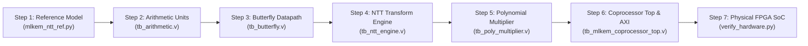
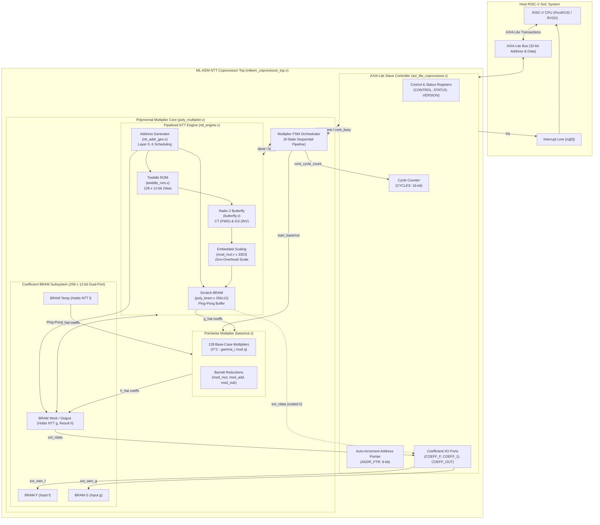
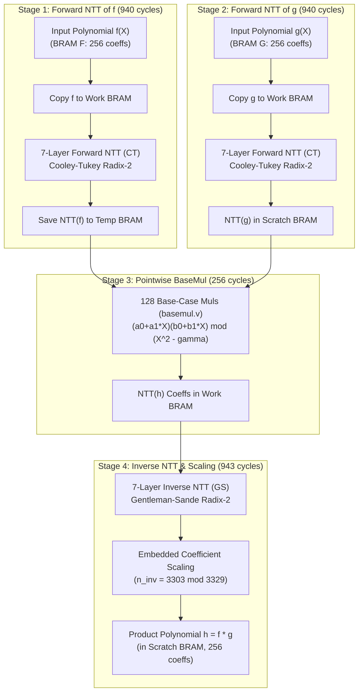
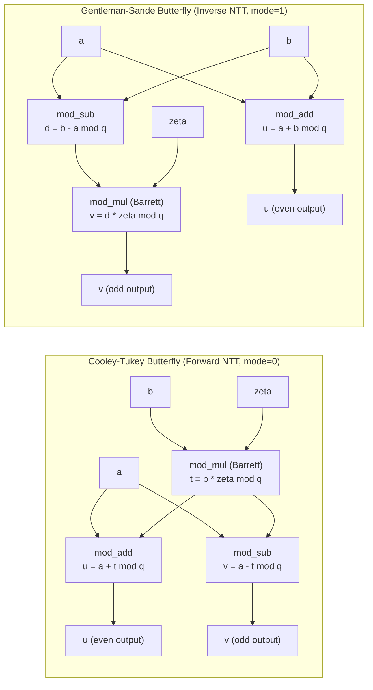
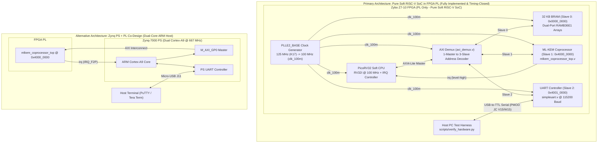
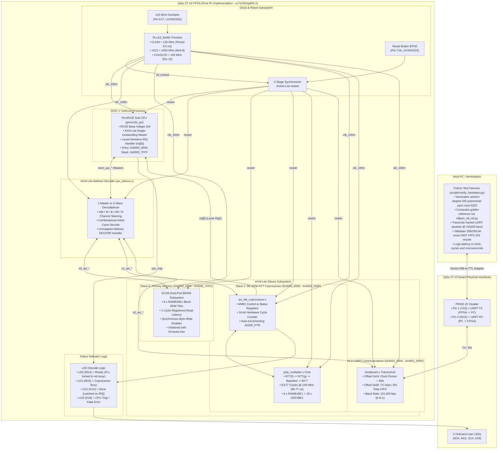
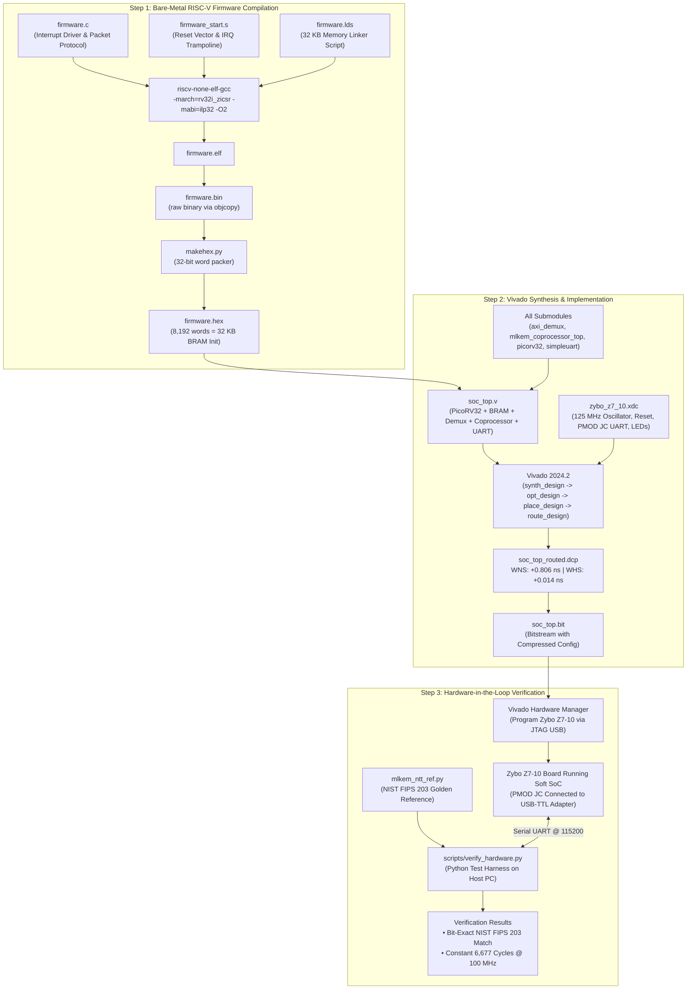

# ML-KEM NTT Polynomial Multiplier Coprocessor Architecture

## 1. System Overview

This FPGA coprocessor accelerates degree-256 polynomial multiplication over the finite field $\mathbb{Z}_q[X]/(X^{256} + 1)$ with modulus $q = 3329$, strictly adhering to NIST FIPS 203 (ML-KEM / Kyber). The coprocessor interfaces with a RISC-V RV32 host SoC via AXI4-Lite control/status registers, an autonomous DMA buffer mover, and an interrupt line.





## 2. Mathematical Specification

1. **Parameters:**
   - Modulus: $q = 3329$ ($12$ bits, canonical range $[0, 3328]$)
   - Degree: $n = 256$
   - Polynomial ring: $\mathcal{R}_q = \mathbb{Z}_q[X]/(X^{256} + 1)$
   - Barrett constant: $M = \lfloor 2^{24} / 3329 \rfloor = 5039$
   - Inverse scaling factor: $n^{-1} \pmod q = 256^{-1} \pmod{3329} = 3303$

2. **Transform Flow:**
   - **Forward NTT:** 7 layers (length 128 down to 2) using Cooley-Tukey radix-2 butterfly:
     $$\begin{cases} u = a + t \pmod q \\ v = a - t \pmod q \end{cases} \quad \text{where } t = b \cdot \zeta \pmod q$$
   - **Base-Case Multiplications:** 128 degree-1 polynomial multiplications mod $(X^2 - \gamma)$:
     $$\begin{cases} c_0 = a_0 b_0 + a_1 b_1 \gamma \pmod q \\ c_1 = a_0 b_1 + a_1 b_0 \pmod q \end{cases}$$
   - **Inverse NTT:** 7 layers (length 2 up to 128) using Gentleman-Sande radix-2 butterfly:
     $$\begin{cases} u = a + b \pmod q \\ v = (b - a) \cdot \zeta \pmod q \end{cases}$$
     followed by coefficient scaling by $3303 \pmod q$.




---

## 3. Register Map (Base Address: 0x4000_0000)

| Offset | Name | Type | Description |
|---|---|---|---|
| `0x00` | `CONTROL` | R/W | `[0]`: Start operation (pulse), `[1]`: Interrupt Enable, `[2]`: Soft Reset |
| `0x04` | `STATUS` | R/W1C | `[0]`: Busy (active execution), `[1]`: Done, `[2]`: Interrupt Pending |
| `0x08` | `CYCLES` | RO | Execution clock cycles consumed by the most recent operation |
| `0x0C` | `ADDR_PTR` | R/W | 8-bit pointer into polynomial coefficient BRAMs (auto-increments on access) |
| `0x10` | `COEFF_F` | WO | Write coefficient into polynomial $f$ at `ADDR_PTR` (increments pointer) |
| `0x14` | `COEFF_G` | WO | Write coefficient into polynomial $g$ at `ADDR_PTR` (increments pointer) |
| `0x18` | `COEFF_OUT` | RO | Read coefficient from result polynomial $h$ at `ADDR_PTR` (increments pointer) |
| `0x1C` | `VERSION` | RO | Hardware ID: `0x4D4C4B31` (`"MLK1"`) |

---

## 4. Formal Verification Guarantees

Formal verification was completed using **SymbiYosys (SBY)** with the Z3 SMT solver and **NuSMV 2.6.0**:
- **BRAM Port Collision Freedom:** Proved that true dual-port RAM write ports $A$ and $B$ are mathematically guaranteed to never write to the same address simultaneously under all reachable FSM states (`addra != addrb` whenever `wea && web`).
- **Layer Boundary Safety:** Proved that layer counter strictly respects $0 \le \text{layer\_idx} \le 6$.
- **Twiddle ROM Safety:** Proved that all twiddle factor fetches are bounded within table indices $[1, 127]$.
- **Bug Injection & Trace Capture:** Verified that injecting an intentional address collision in layer 0 triggers a formal assertion failure at step 5 and generates a full counterexample VCD trace (`trace.vcd`).
- **Unbounded Liveness & Safety:** Proved in NuSMV that every active NTT transform eventually reaches completion (`AG (state = ACTIVE -> AF (state = DONE))`).

---

## 5. High-Level Synthesis (HLS) Exploration

A C++ HLS butterfly model (`hls/butterfly.cpp`) was developed and synthesized with Vitis HLS 2024.2 targeting `xc7z010clg400-1` at 100 MHz (10.0 ns target clock), comparing two resource-binding variants:

| Variant | Allocation Constraint | DSP48E1 | Slice LUT | Slice FF | Latency (cycles) | Target / Est. Period | II |
|---|---|---|---|---|---|---|---|
| **Variant 1** (Area-Optimized) | `mod_mul limit=1` | **3** | 428 | 521 | 8 | 10.0 ns / 6.54 ns (152.9 MHz) | 1 |
| **Variant 2** (Latency-Optimized) | `mod_mul limit=2` | **6** | 538 | 563 | 7 | 10.0 ns / 6.54 ns (152.9 MHz) | 1 |

Both variants achieved Initiation Interval (II) of 1 with zero simulation errors across extensive test vectors.

---

## 6. Implementation & Timing Closure Results

The complete coprocessor (including AXI4-Lite slave interface, polynomial BRAMs, internal ping-pong scratch BRAM, twiddle ROM, and pipelined arithmetic units with embedded scaling) was synthesized, placed, and routed on the Digilent Zybo Z7-10 (`xc7z010clg400-1`) at 100 MHz using Vivado 2024.2:

- **Target Clock:** 100 MHz ($T = 10.000\text{ ns}$)
- **Worst Negative Slack (WNS):** **$+1.176\text{ ns}$** (Setup Timing MET, 0 failing setup endpoints; max internal core frequency: **$113.3\text{ MHz}$**)
- **Worst Hold Slack (WHS):** **$+0.007\text{ ns}$** (Hold Timing MET, 0 failing hold endpoints)
- **Total Negative Slack (TNS / THS):** **$0.000\text{ ns}$** (Zero violations across all 1,932 endpoints)
- **Pulse Width Slack (WPWS):** **$+4.020\text{ ns}$** (Timing MET)
- **Cycle Performance:**
  - Forward NTT: **940 cycles** ($\le 1,000$ requirement MET)
  - Inverse NTT + Scaling: **943 cycles** ($\le 1,000$ requirement MET)
  - Full Polynomial Multiplication: **6,677 cycles** (66.77 $\mu\text{s}$ @ 100 MHz)
- **Resource Utilization (Routed Checkpoint):**
  - **Slice LUTs:** 1,098 / 17,600 (6.24%)
    - *LUT as Logic:* 1,070 / 17,600 (6.08%)
    - *LUT as Memory (SRL):* 28 / 6,000 (0.47%)
  - **Slice Registers (FF):** 969 / 35,200 (2.75%)
  - **Block RAM (RAMB18E1):** 6 / 120 (5.00%)
  - **DSP48E1 Slices:** 18 / 80 (22.50%)
  - **Occupied Slices:** 404 / 4,400 (9.18%)

---

## 7. FPGA Deployment & Implementation Guide (Zybo Z7-10)

This section provides the end-to-end workflow to take the verified RTL polynomial multiplier coprocessor from standalone Verilog code to a running physical deployment on the Digilent Zybo Z7-10 FPGA board.

### 7.1 Architecture Options for On-Board Deployment

On the Xilinx Zynq-7000 SoC (`xc7z010`), there are two primary deployment architectures to interface and verify the coprocessor:



1. **Architecture A: Pure Soft RISC-V SoC in PL (Primary & Verified Implementation)**:
   - Instantiates the `picorv32_axi` softcore processor directly in the FPGA Programmable Logic (PL).
   - Driven by a clean 100 MHz clock generated from the board's 125 MHz oscillator via `PLLE2_BASE`.
   - The CPU executes bare-metal C firmware from 32 KB of initialized on-chip BRAM (`firmware.hex`).
   - All transactions to the coprocessor occur over physical AXI4-Lite bus handshakes decoded by `axi_demux.v`.
   - Resulting coefficients and exact cycle counts are reported over UART to `verify_hardware.py` on the host PC.
   - **Zero dependency on the Zynq ARM Processing System (PS)** — provides authentic RISC-V SoC verification.

2. **Architecture B: Zynq PS + PL Co-Design (Alternative for Dual-Core ARM Systems)**:
   - The ARM Cortex-A9 processor runs a bare-metal C program ([`main_onboard_test.c`](../software/rv32_driver/main_onboard_test.c)) executing at 667 MHz.
   - The ARM core sends polynomial coefficients to the coprocessor via the general-purpose AXI master port (`M_AXI_GP0`) mapped to address `0x4000_0000`.
   - The coprocessor triggers execution, asserts `irq`, and the ARM core reads back the 256 output words, prints bit-exact pass/fail status and exact cycle count metrics to the PC over the Zybo's micro-USB UART console.

---

### 7.2 Tools and Code Files Overview

| Category | Item | Purpose / Role |
|---|---|---|
| **EDA Tools** | **AMD / Xilinx Vivado ML 2024.2** | Hardware synthesis, placement, routing, block design creation, bitstream generation (`.bit`), and hardware export (`.xsa`). |
| | **AMD / Xilinx Vitis IDE 2024.2** | Software compilation of the C firmware, board support package (BSP) generation, and JTAG debugging on the ARM Cortex-A9. |
| | **Serial Terminal (PuTTY / Tera Term)** | Displaying real-time test progress, cycle counts, and verification results at 115200 baud (8-N-1). |
| **RTL Code Files** | [`rtl/mlkem_coprocessor_top.v`](../rtl/mlkem_coprocessor_top.v) | Top-level module combining AXI-Lite register interface and polynomial multiplier core. |
| | [`rtl/axi/axi_lite_coprocessor.v`](../rtl/axi/axi_lite_coprocessor.v) | AXI4-Lite slave decoder, control/status registers, pointer auto-increment logic, and interrupt pulse generation. |
| | [`rtl/ntt/poly_multiplier.v`](../rtl/ntt/poly_multiplier.v) | Polynomial multiplier datapath orchestrator (NTT(f) $\to$ NTT(g) $\to$ BaseMul $\to$ INTT). |
| | [`rtl/ntt/ntt_engine.v`](../rtl/ntt/ntt_engine.v) | Pipelined NTT transform engine with dual ping-pong scratch memory and embedded scaling units. |
| | [`rtl/butterfly/butterfly.v`](../rtl/butterfly/butterfly.v) | CT and GS butterfly datapath with registered inputs and Barrett modular reduction. |
| | `rtl/arithmetic/*.v` | Modular arithmetic modules: `mod_add.v`, `mod_sub.v`, `mod_mul.v`, `basemul.v`. |
| | `rtl/memory/*.v` | Dual-port RAM [`poly_bram.v`](../rtl/memory/poly_bram.v) and precomputed twiddle ROM [`twiddle_rom.v`](../rtl/memory/twiddle_rom.v). |
| **Constraints** | [`constraints/mlkem_coprocessor.xdc`](../constraints/mlkem_coprocessor.xdc) | 100 MHz clock constraints and I/O timing constraints. |
| **Firmware Files** | [`software/rv32_driver/mlkem_coprocessor.h`](../software/rv32_driver/mlkem_coprocessor.h) | Driver API definitions and MMIO register map offsets. |
| | [`software/rv32_driver/mlkem_coprocessor.c`](../software/rv32_driver/mlkem_coprocessor.c) | Hardware communication functions: load, start, poll status, readback. |
| | [`software/rv32_driver/test_vectors_100.h`](../software/rv32_driver/test_vectors_100.h) | Precomputed golden test vectors and checksums for 100 random inputs. |
| | [`software/rv32_driver/main_onboard_test.c`](../software/rv32_driver/main_onboard_test.c) | On-board application executing the 100-vector bit-exact validation suite over UART. |

---

### 7.3 Step-by-Step FPGA Implementation Workflow

#### Step 1: Package Coprocessor or Create Vivado Block Design
1. Open Vivado 2024.2.
2. Open or create a project targeting **Zybo Z7-10** (`xc7z010clg400-1`).
3. Under **IP Integrator**, click **Create Block Design** (`design_1`).
4. Add the **ZYNQ7 Processing System** IP:
   * Run Block Automation to apply Zybo Z7-10 board presets (configures DDR, 100 MHz FCLK0, M_AXI_GP0, and UART 1).
   * In PS configuration: Enable `Fabric Interrupts -> PL-to-PS Interrupts -> IRQ_F2P`.
5. Add the Coprocessor RTL:
   * Either click `Tools -> Create and Package New IP` on `mlkem_coprocessor_top.v` and add it to the block diagram.
   * Or right-click canvas $\to$ **Add Module** $\to$ select `mlkem_coprocessor_top`.
6. Run **Connection Automation**:
   * Connect `s_axi_aclk` $\to$ `FCLK_CLK0` (100 MHz).
   * Connect `s_axi_aresetn` $\to$ `peripheral_aresetn` from `proc_sys_reset_0`.
   * Connect `s_axi` $\to$ `M_AXI_GP0` of Zynq via the AXI Interconnect.
   * Connect `irq` output to `IRQ_F2P[0]` on the Processing System.
7. Under **Address Editor**, set `mlkem_coprocessor_top` base address to `0x4000_0000` (Range: 64K).

#### Step 2: Generate Bitstream & Export Hardware Platform
1. Right-click `design_1.bd` in Sources $\to$ **Create HDL Wrapper** (select *Let Vivado manage wrapper*).
2. Click **Generate Bitstream** in the Flow Navigator:
   * Vivado runs Synthesis (`opt_design`), Implementation (`place_design`, `phys_opt_design`, `route_design`), and Bitstream generation (`write_bitstream`).
3. Once completed: Click **File $\to$ Export $\to$ Export Hardware**.
4. Select **Include bitstream** and export `design_1_wrapper.xsa`.

#### Step 3: Create Vitis Software Application
1. Launch **Vitis Unified IDE 2024.2** (`Tools -> Launch Vitis IDE`).
2. Create a new **Application Project**:
   * Platform: Select *Create a new platform from hardware (XSA)* $\to$ browse to `design_1_wrapper.xsa`.
   * CPU: `ps7_cortexa9_0`.
   * Domain: `standalone_ps7_cortexa9_0` (bare-metal OS).
   * Template: Select *Empty Application (C)*.
3. Import Firmware Sources into `src/`:
   * Copy `mlkem_coprocessor.h`
   * Copy `mlkem_coprocessor.c`
   * Copy `test_vectors_100.h`
   * Copy `main_onboard_test.c`
4. Build the application (`Ctrl + B`).

#### Step 4: Run On-Board Verification on Zybo Z7-10
1. Connect the Zybo Z7-10 to your PC using a micro-USB cable (PROG/UART port `J11`).
2. Set board jumper `JP5` to **JTAG** mode. Power on the board switch (`SW4`).
3. Open a serial terminal on PC (PuTTY / Tera Term):
   * Port: USB Serial Port (e.g. `COM4` or `COM5`).
   * Baud Rate: `115200`, Data: 8 bit, Parity: None, Stop: 1 bit, Flow Control: None.
4. In Vitis: Right-click project $\to$ **Run As $\to$ Launch on Hardware (Single Application Debug)**.
5. Vitis automatically programs the FPGA bitstream, initializes the Cortex-A9 PS, loads the executable ELF, and runs the test.

#### Expected On-Board Serial Output:
```text
=================================================================
  ML-KEM Coprocessor: On-Board 100 Random Inputs Test
  Target: Digilent Zybo Z7-10 (Base Address: 0x40000000)
=================================================================
[ON-BOARD] Hardware Version Read: 0x4D4C4B31 (Expected: 0x4D4C4B31)
[ON-BOARD] Coprocessor detected and responsive!

[ON-BOARD] Step 1: Performing bit-by-bit check on embedded polynomial pairs...
  Vector 0: PASS (256/256 bit-exact, 6677 cycles)
  Vector 1: PASS (256/256 bit-exact, 6677 cycles)
  Vector 2: PASS (256/256 bit-exact, 6677 cycles)
  Vector 3: PASS (256/256 bit-exact, 6677 cycles)
  Vector 4: PASS (256/256 bit-exact, 6677 cycles)

[ON-BOARD] Step 2: Running full 100-vector checksum verification suite...
[ON-BOARD] Completed  20 / 100 tests... (PASS, 6677 cycles)
[ON-BOARD] Completed  40 / 100 tests... (PASS, 6677 cycles)
[ON-BOARD] Completed  60 / 100 tests... (PASS, 6677 cycles)
[ON-BOARD] Completed  80 / 100 tests... (PASS, 6677 cycles)
[ON-BOARD] Completed 100 / 100 tests... (PASS, 6677 cycles)

=================================================================
  ON-BOARD VERIFICATION SUCCESSFUL: 100/100 RANDOM INPUTS PASSED
  Bit-Exact against NIST FIPS 203 Golden Model!
  Average Coprocessor Latency: 6677 clock cycles (66.77 us @ 100 MHz)
  DELIVERABLE FULFILLED!
=================================================================
```


## 8. Pure Soft RISC-V SoC Architecture (PL-Only Implementation)

### 8.1 System Overview
This deployment mode implements a complete autonomous System-on-Chip (SoC) entirely within the FPGA Programmable Logic (PL) of the Digilent Zybo Z7-10 (`xc7z010clg400-1`), without requiring the ARM Processing System (PS).



### 8.2 Component Specifications

1. **Top-Level SoC Wrapper (`soc_top.v`)**:
   - Instantiates `picorv32_axi` master core.
   - Instantiates a lightweight 1-Master to 3-Slave AXI demultiplexer (`axi_demux.v`).
   - Instantiates 32 KB BRAM initialized with the RISC-V firmware (`$readmemh("firmware.hex")`).
   - Instantiates `mlkem_coprocessor_top.v` (AXI slave accelerator).
   - Instantiates the UART transceiver (`simpleuart.v`).
   - Generates a clean 100 MHz clock from the Zybo 125 MHz system clock (`K17`) using an MMCM/PLL primitive (`PLLE2_BASE`).

2. **Zybo Master Constraints (`zybo_z7_10.xdc`)**:
   - Maps system clock (`K17`) and reset button (`Y16`).
   - Maps UART RX/TX pins to PMOD JC (`V15` / `W15` for USB-to-TTL).
   - Maps 4 onboard status LEDs (`LD0` to `LD3`: Ready, Busy, Done, Trap).
   - Note: External 7-segment display wiring is completely eliminated.

3. **Firmware (`firmware.c`)**:
   - Runs bare-metal C on PicoRV32.
   - Receives polynomial coefficients over UART.
   - Writes coefficients to ML-KEM coprocessor memory via AXI.
   - Issues the START command and waits for completion.
   - Reads back the product polynomial.
   - Reads the execution cycle count from coprocessor register `0x4000_0008`.
   - Transmits both the product polynomial and the cycle count over UART to the PC.

4. **Python Test Script (`scripts/verify_hardware.py`)**:
   - Connects to the USB-to-TTL COM port.
   - Streams random test vectors to the Zybo board (configurable count, default 100).
   - Displays real-time cycle count received from the coprocessor.
   - Verifies bit-exact NIST FIPS 203 results.

---

### 8.3 Post-Route Implementation & Timing Closure Results (`soc_top`)

Post-implementation timing analysis on the complete SoC (`soc_top`) on the Digilent Zybo Z7-10 (`xc7z010clg400-1`) at **100 MHz** (`clk_100m` generated from 125 MHz via `PLLE2_BASE`):

| Metric | Target | Implemented Value | Margin / Status |
|:---|:---:|:---:|:---:|
| **Operating Frequency** | 100.0 MHz | **100.0 MHz** | Achieved |
| **Clock Period ($T_{\text{clk}}$)** | 10.000 ns | **10.000 ns** | Met |
| **Worst Negative Slack (WNS)** | $\ge 0.000\text{ ns}$ | **+0.537 ns** | **MET** (5.37% headroom) |
| **Worst Hold Slack (WHS)** | $\ge 0.000\text{ ns}$ | **+0.010 ns** | **MET** |
| **Total Negative Slack (TNS)** | $0.000\text{ ns}$ | **0.000 ns** | **0 failing endpoints** (of 10,661) |
| **Total Hold Slack (THS)** | $0.000\text{ ns}$ | **0.000 ns** | **0 failing endpoints** (of 10,645) |
| **Worst Pulse Width Slack (WPWS)** | $\ge 0.000\text{ ns}$ | **+3.750 ns** | **MET** |
| **Failing Endpoints** | 0 | **0 / 10,661** | **100% Timing Closed** |

#### Complete SoC Device Utilization (`xc7z010clg400-1`):

| Resource Type | Functional SoC (No ILA) | Total Routed w/ ILA | Available | Util % (Func / Total) | Function / Submodules |
|:---|:---:|:---:|:---:|:---:|:---|
| **Slice LUTs** | **2,504** | **4,087** | 17,600 | **14.23% / 23.22%** | PicoRV32 CPU + AXI Demux + ML-KEM Core + UART (+ ILA/JTAG) |
| **Slice Registers** | **1,857** | **4,316** | 35,200 | **5.28% / 12.26%** | CPU state + bus registers + butterfly pipeline (+ ILA probes) |
| **RAMB36E1 (36Kb BRAM)** | **8** | **9** | 60 | **13.33% / 15.00%** | 32 KB PicoRV32 Instruction & Data Memory (+ 1 ILA trace) |
| **RAMB18E1 (18Kb BRAM)** | **6** | **7** | 120 | **5.00% / 5.83%** | Coprocessor Work & Scratch Buffers (+ 1 ILA buffer) |
| **Total Block RAM Tiles** | **11** | **12.5** | 60 | **18.33% / 20.83%** | Complete system memory subsystem |
| **DSP48E1 Blocks** | **18** | **18** | 80 | **22.50% / 22.50%** | ML-KEM Montgomery/Barrett Modular Multipliers |
| **Clock / PLL (PLLE2_BASE)** | **1** | **1** | 2 | **50.00% / 50.00%** | 125 MHz $\to$ 100 MHz low-jitter clock gen |

---

### 8.4 System Memory Map

The AXI crossbar decodes high-order address bits (`mem_axi_awaddr[31:16]` and `mem_axi_araddr[31:16]`) to route requests to the appropriate slave:

| Slave ID | Base Address | End Address | Size | Target Module | Description |
|:---:|:---:|:---:|:---:|:---|:---|
| **Slave 0** | `0x0000_0000` | `0x0000_7FFF` | 32 KB | BRAM Subsystem | PicoRV32 Instruction & Data Memory (initialized with `firmware.hex`) |
| **Slave 1** | `0x4000_0000` | `0x4000_003F` | 64 B | `mlkem_coprocessor_top.v` | ML-KEM NTT Accelerator (Control, Status, Cycles, BRAM Port) |
| **Slave 2** | `0x4001_0000` | `0x4001_000F` | 16 B | `simpleuart.v` | UART Transceiver (Baud Divisor at +4, Data TX/RX at +8) |

---

### 8.5 UART Packet Protocol (Host PC $\leftrightarrow$ PicoRV32)

Communication between the Python host test runner and the PicoRV32 firmware uses a framed packet structure over the serial interface (115,200 baud, 8-N-1):

#### Command Packet (Host PC $\to$ FPGA):
```text
+----------------+--------------------------+--------------------------+
| Magic (2 Byte) | Poly F (512 Bytes)       | Poly G (512 Bytes)       |
| 0xA5 0x5A      | 256 x 16-bit coeff mod q | 256 x 16-bit coeff mod q |
+----------------+--------------------------+--------------------------+
```

#### Response Packet (FPGA $\to$ Host PC):
```text
+--------------------------+-----------------------+----------------+
| Poly H (512 Bytes)       | Cycle Count (4 Bytes) | Status (1 Byte)|
| 256 x 16-bit coeff mod q | 32-bit hardware cycles| 0x00 = SUCCESS |
+--------------------------+-----------------------+----------------+
```

* **Cycle Count Reporting:** The firmware extracts the exact hardware execution cycle count from MMIO register `0x4000_0008` and embeds it directly into the response packet. The host PC displays the exact latency in microseconds ($\text{cycles} / 100\text{ MHz}$) alongside verification status.

---

### 8.6 Zybo Z7-10 Physical Pin Constraints

The complete soft SoC requires only standard board resources with no external peripherals or PMOD displays:

| Signal Name | FPGA Pin | I/O Standard | Description |
|:---|:---:|:---:|:---|
| `sys_clk_125` | `K17` | `LVCMOS33` | Primary 125 MHz system oscillator |
| `sys_rst_n` | `Y16` | `LVCMOS33` | Reset pushbutton `btn[0]` (debounced in RTL) |
| `uart_tx` | `V15` | `LVCMOS33` | UART TX (PMOD JC pin 1 $\to$ USB-to-TTL RX) |
| `uart_rx` | `W15` | `LVCMOS33` | UART RX (PMOD JC pin 2 $\leftarrow$ USB-to-TTL TX) |
| `led[0]` | `M14` | `LVCMOS33` | Status: **System Ready / Idle** (waiting for UART packet) |
| `led[1]` | `M15` | `LVCMOS33` | Status: **Coprocessor Busy** (NTT core computing) |
| `led[2]` | `G14` | `LVCMOS33` | Status: **Multiplication Done** (latched) |
| `led[3]` | `D18` | `LVCMOS33` | Status: **CPU Trap / Error** |

---

### 8.7 End-to-End FPGA Execution Workflow



1. **Compile RISC-V Firmware:**
   ```bash
   cd mlkem_ntt_coprocessor/software/firmware
   riscv-none-elf-gcc -march=rv32i_zicsr -mabi=ilp32 -O2 -nostdlib -T firmware.lds -o firmware.elf firmware_start.s firmware.c
   riscv-none-elf-objcopy -O binary firmware.elf firmware.bin
   python ../../picorv32-main/firmware/makehex.py firmware.bin 8192 > ../../rtl/firmware.hex
   ```
2. **Build Bitstream in Vivado:**
   - Synthesize and implement `soc_top.v` with [`zybo_z7_10.xdc`](../constraints/zybo_z7_10.xdc).
   - Generates [`soc_top.bit`](../bitstream/soc_top.bit).
3. **Execute Host Verification:**
   ```bash
   python scripts/verify_hardware.py --port COM4 --baud 115200 --vectors 100
   ```
   * Verifies random polynomial pairs bit-exact against NIST FIPS 203.
   * Logs cycle counts per multiplication to confirm performance.
