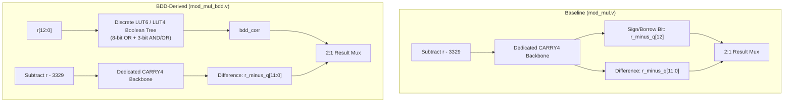

# Physical Implementation and Synthesis Evaluation: $x \ge q$ Modular Correction Logic

## 1. Executive Summary

This report evaluates the physical hardware implementation impact of replacing the baseline arithmetic subtractor borrow-bit comparator with the BDD-derived discrete Boolean comparator in the Barrett modular multiplier ([`rtl/arithmetic/mod_mul.v`](../../rtl/arithmetic/mod_mul.v)).

- **Target Device:** Xilinx Zynq-7000 SoC (`xc7z010clg400-1`)
- **Synthesis Tool:** AMD Vivado 2024.2
- **Design Strategy:** Out-of-context synthesis and physical implementation with full placement and routing (`opt_design`, `place_design`, `route_design`).
- **Clock Constraint:** $100\text{ MHz}$ ($T_{\text{clk}} = 10.000\text{ ns}$).
- **Core Finding:** While the BDD representation is mathematically minimal (13 internal decision nodes), translating it into an explicit discrete Boolean gate tree **degrades hardware efficiency**:
  - **LUT Utilization:** Increases from **52 LUTs** to **57 LUTs** (+9.6% resource penalty).
  - **LUT6 Primitives:** Increases from **1** to **7** (+600% increase in wide logic gates).
  - **Timing Slack (WNS):** Decreases from **+3.539 ns** to **+3.321 ns** ($-0.218\text{ ns}$ timing degradation).
  - **Maximum Achievable Frequency ($F_{\max}$):** Drops from **$154.77\text{ MHz}$** to **$149.72\text{ MHz}$** ($-5.05\text{ MHz}$).

> [!IMPORTANT]
> In Xilinx 7-series FPGAs, dedicated arithmetic carry chains (`CARRY4`) compute subtraction and borrow generation simultaneously with minimal routing latency. Decomposing the comparison into discrete LUT-based Boolean logic bypasses the hardened carry backbone, requiring general routing and additional LUT6 slices.

---

## 2. Experimental Setup & RTL Variants

To preserve baseline integrity, the BDD-derived comparator was implemented in a dedicated clean module [`rtl/arithmetic/mod_mul_bdd.v`](../../rtl/arithmetic/mod_mul_bdd.v). Both modules were synthesized and implemented under identical scripts and physical constraints using Vivado 2024.2 via [`scripts/compare_mod_mul_synth.tcl`](../../scripts/compare_mod_mul_synth.tcl).

### 2.1 Baseline Implementation (`rtl/arithmetic/mod_mul.v`)
Uses arithmetic borrow from the dedicated 13-bit subtraction:
```verilog
wire [12:0] r_minus_q = r - Q;
wire [11:0] next_result = r_minus_q[12] ? r[11:0] : r_minus_q[11:0];
```
The condition is detected directly from bit 12 of the subtractor, which is computed concurrently inside the `CARRY4` chain.

### 2.2 BDD-Derived Implementation (`rtl/arithmetic/mod_mul_bdd.v`)
Uses the minimal SOP Boolean equation extracted from the optimal ROBDD:
```verilog
wire [12:0] r_minus_q = r - Q;
// BDD-derived Boolean comparator for r >= 3329:
wire bdd_corr = r[12] | (r[11] & r[10] & (r[9] | (r[8] & (|r[7:0]))));
wire [11:0] next_result = bdd_corr ? r_minus_q[11:0] : r[11:0];
```

---

## 3. Physical Synthesis and Implementation Results

The following metrics are extracted directly from the post-route Vivado implementation reports ([`baseline_util.rpt`](baseline_util.rpt), [`baseline_timing.rpt`](baseline_timing.rpt), [`bdd_variant_util.rpt`](bdd_variant_util.rpt), [`bdd_variant_timing.rpt`](bdd_variant_timing.rpt)):

### 3.1 Resource Utilization Comparison

| Metric / Primitive | Baseline (`mod_mul.v`) | BDD-Derived (`mod_mul_bdd.v`) | Delta ($\Delta$) | Percentage Impact |
| :--- | :---: | :---: | :---: | :---: |
| **Slice LUTs** | **52** | **57** | **+5** | **+9.62%** |
| - LUT as Logic | 52 | 57 | +5 | +9.62% |
| - LUT6 Primitives | 1 | 7 | +6 | +600.0% |
| - LUT4 Primitives | 4 | 11 | +7 | +175.0% |
| - LUT3 Primitives | 30 | 10 | -20 | -66.7% |
| - LUT2 Primitives | 38 | 34 | -4 | -10.5% |
| - LUT1 Primitives | 1 | 9 | +8 | +800.0% |
| **Slice Registers (FFs)** | **26** | **26** | **0** | **0.00%** |
| **CARRY4 Primitives** | **9** | **9** | **0** | **0.00%** |
| **DSP48E1 Blocks** | **2** | **2** | **0** | **0.00%** |
| **Total Slices Occupied**| 18 | 19 | +1 | +5.56% |

### 3.2 Timing Performance Comparison (100 MHz Target)

| Timing Metric | Baseline (`mod_mul.v`) | BDD-Derived (`mod_mul_bdd.v`) | Delta ($\Delta$) | Impact |
| :--- | :---: | :---: | :---: | :---: |
| **Worst Negative Slack (WNS)** | **+3.539 ns** | **+3.321 ns** | **-0.218 ns** | Slower |
| **Total Negative Slack (TNS)** | 0.000 ns | 0.000 ns | 0.000 ns | Meets timing |
| **Worst Hold Slack (WHS)** | +0.540 ns | +0.549 ns | +0.009 ns | Meets timing |
| **Worst Pulse Width Slack (WPWS)**| +4.500 ns | +4.500 ns | 0.000 ns | Equal |
| **Data Path Delay (Critical Path)**| 2.424 ns | 2.642 ns | +0.218 ns | +9.0% latency |
| **Maximum Frequency ($F_{\max}$)** | **154.77 MHz** | **149.72 MHz** | **-5.05 MHz** | **-3.26%** |

$$\text{Note: } F_{\max} = \frac{1}{T_{\text{clk}} - \text{WNS}} = \frac{1}{10.0\text{ ns} - \text{WNS}}$$

---

## 4. Architectural Analysis: Why Hardware Fails to Benefit from the BDD

In algorithmic logic synthesis, BDD minimization is often assumed to directly yield smaller and faster circuits. However, on modern FPGA architectures with specialized hardened primitives, this assumption frequently breaks down:



### 4.1 Redundant Evaluation
In the baseline, the subtractor `r - Q` must be computed anyway to obtain the corrected value $r - 3329$. Because the 13-bit carry chain (`CARRY4`) naturally produces the MSB borrow bit at its terminal stage, the comparison comes virtually **free of charge** in both area and delay.

In the BDD variant, the hardware computes `r - Q` via carry chains AND simultaneously builds an independent discrete LUT comparator network. This redundancy directly causes:
1. **+6 LUT6 Primitives:** To evaluate $r_{12} \lor (r_{11} r_{10} (r_9 \lor (r_8 (|r[7:0]))))$, the wide 8-bit reduction $|r[7:0]$ and subsequent multi-level gating consume dedicated 6-input LUTs that would otherwise not exist.
2. **General Routing Interconnect:** Unlike the dedicated ultra-fast internal carry-lookahead interconnects inside a slice, routing the BDD tree requires generic routing matrix tracks, increasing data path delay from $2.424\text{ ns}$ to $2.642\text{ ns}$.

---

## 5. Architectural Recommendation

1. **Retain Original Baseline in Production:** The baseline implementation in `rtl/arithmetic/mod_mul.v` represents the optimal hardware mapping for Xilinx 7-series FPGAs, delivering lower area (52 LUTs) and higher maximum frequency (154.77 MHz).
2. **Value of the BDD Analysis:** The BDD analysis accomplished two critical engineering objectives:
   - **Formally verified** that the RTL comparison behaves as $x \ge q$ rather than $x > q$, establishing ring compliance for NIST FIPS 203.
   - **Characterized the don't-care space** ($r \in [4904, 8191]$), proving that potential borrow-bit overflow at $r \ge 7425$ is strictly unreachable in the datapath.
